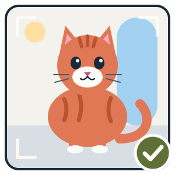
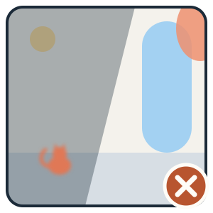
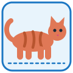

# Photo tips, and a face photo and a body photo in the same spot

**Status:** Draft for Samuel's approval, 15 October 2026. Samuel answered the five product decisions on 15 October 2026, all as recommended (§10). An independent adversarial review (Sonnet) of the first draft found 3 blockers, 12 major and 7 minor issues. All are dealt with in this version. The review and what was done about each finding are in [`reviews/photo-tips-and-extra-photos-review.md`](./reviews/photo-tips-and-extra-photos-review.md).
**Owner:** Samuel
**Covers:** SYC-415 (Urgent). Samuel, 15 October: some testers' photos are poorly composed, which hurts data quality and matching.
**Related:** SYC-163 (adding photos to a cat later, and by the team, guardians and vets: this spec is its urgent slice) · SYC-157 (a "Retake / Use this photo" step) · SYC-118 ("Retake photo") · SYC-61 (teaching delivered as moments) · SYC-161 (coat colour read from the main photo) · SYC-151 and SYC-408 (match records) · SYC-46 and SYC-81 (where photos are stored, and shrinking old ones) · SYC-279 (hidden photos still cached on phones) · [`photo-location-from-library.md`](./photo-location-from-library.md) (the photo's time, the 21-day rule, "already logged") · [`offline-queue-on-web.md`](./offline-queue-on-web.md) · [`hosting-and-photo-storage.md`](./hosting-and-photo-storage.md) · [`report-an-issue.md`](./report-an-issue.md) · [`cat-record-data-spine.md`](./cat-record-data-spine.md) §8.5 (deleting data) · [`feeding-nudge.md`](./feeding-nudge.md) (the "full once, then short" pattern)

**What this document owns.** The photo tips a spotter sees before taking or picking a photo, and how one spot carries up to three photos: the first photo, a face photo and a body photo. It also owns which photo stands for the spot, what matching does with the photos, and which one becomes a new cat's main photo. It does **not** own adding photos to a cat after the spot, uploads by the team, or changing a cat's main photo later. Those stay with SYC-163.

---

## 1. The short version

Two changes to spotting a cat.

**Photo tips.** The first time someone opens the camera to spot a cat, a card shows them what a good cat photo looks like: a cartoon of a good photo next to a poor one, and four short tips. One tap closes it. After that, a small **"Photo tips"** link sits on the camera screen for anyone who wants a reminder. The tips always reappear on the screen that says a photo doesn't show a cat.

**A face photo and a body photo.** After the first photo, the New spot screen offers two optional extra photos: **"Add the face"** and **"Add the whole body"**, each with a cartoon showing the shot it wants. The spotter can add one, both or neither, then carries on. Nothing is required, so a cat that walks off after one photo can still be spotted.

All of a spot's photos go to matching together, so the matcher sees the new cat from more than one angle. When the spot creates a new cat, the **face photo** becomes the cat's main photo if there is one. Every photo is kept and shows on the cat's page.

| | Tourists | Cat guardians and residents |
|---|---|---|
| **What they get from the tips** | Shown once, on their first spot. Most tourists only spot a few cats, so it has to land the first time. | Shown once. The "Photo tips" link is there if they want it, and it never gets in the way of regulars. |
| **What they get from extra photos** | A cat they photographed once on holiday has a better chance of being recognised by the next visitor. | Their regular cats get a clear face and body on record, so the catalogue tells look-alike cats apart. |

Both audiences want the same thing: the right cat on the right record. Tourists supply many of the photos, and locals rely on the record being right.

---

## 2. Why this matters

Every spot is matched against the main photos of nearby cats. A poor photo hurts twice:

1. **When it's sent.** A tiny, blurry or rear view gives the matcher little to go on, so the right cat may not be suggested and a duplicate cat gets made.
2. **For every later spot of that cat.** If the poor photo becomes a new cat's main photo, every future spot of that cat is matched against it, and colour reading (SYC-161) reads it too.

The best way to fix this is at the moment the photo is taken. Fixing records afterwards costs the team time and never fully catches up.

The face and the coat pattern are the two things that tell cats apart, and one photo rarely shows both clearly. So we ask for both, and accept whatever the spotter manages.

---

## 3. Photo tips

### 3.1 The tips card

 

The card shows the two cartoons side by side: the good photo with a green tick, and the poor one (tiny, far away, turned away, blurry, in shadow, with a thumb in the corner) with a red cross. Below them come four tips:

| Tip | Line under it |
|---|---|
| **Get close** | Fill the frame with the cat. |
| **Show the face** | Wait for it to look your way. |
| **Show the whole body** | Nose to tail, so the coat pattern shows. |
| **Daylight, and hold still** | Step into the light, and don't zoom if you can help it. |

**Title:** "How to take a great cat photo". **Button:** "Got it". The button closes the card and leaves the camera screen ready. It never opens the phone's camera or photo picker by itself: browsers only allow that from a direct tap on the shutter.

On a 390px-wide phone the two cartoons sit side by side at about 150px each, with the tips in one column below. The card scrolls on short screens. It has one button and no "don't show again" box, because it only shows once anyway.

### 3.2 When it shows

1. **The first time** the spotter reaches the camera on the Spot tab, over the camera screen. Once "Got it" is tapped it doesn't show again on that phone. If the app is closed with the card open, it shows again next time.
2. **From the "Photo tips" link** on the camera screen, with a small lightbulb icon, at any time. It sits away from the shutter, so nobody taps it by mistake.
3. **On the "this doesn't look like a cat" screen.** That screen shows the two cartoons and the four tips under its message, above "Try again". This is when someone most needs them, so they always show here.

The "seen" mark is kept on the phone alongside the app's other "seen once" marks. "Delete my data" clears it deliberately, so a tester who starts afresh sees the card again. A spotter on a second phone sees it once there too.

### 3.3 Words in every language

All the card's text, the extra-photo text (§4) and every new message go into English, Greek and French. The Greek and French get a native-speaker check under SYC-4 before launch. The cartoons contain no words.

### 3.4 Accessibility

Each cartoon has a description a screen reader reads aloud, for example *"A good cat photo: the cat fills the frame, its face and whole body showing, in daylight."* The tick and the cross are described in words, not left as symbols.

### 3.5 With no signal

The cartoons are built into the app, not fetched from the web. In the phone app, the card, the extra-photo buttons and the "Photo tips" link all work with no signal. On the website they work with no signal as long as the page is already open. Reloading the website with no signal doesn't work for any page.

---

## 4. A face photo and a body photo

### 4.1 What the spotter sees

After the first photo (camera or library), the New spot screen shows:

* **The first photo**, with "Retake photo", as on any spot (SYC-118).
* Below it, one line: *"Got the face and the whole body? Add them so we can tell this cat apart. Same cat only."*
* Below that, **two boxes side by side**, each about half the screen's width: **"Add the face"** with the face cartoon, and **"Add the whole body"** with the body cartoon.

 

The boxes have a dashed outline and a ＋. They look nothing like "Retake photo", which is a text button under the first photo, so nobody mistakes adding a photo for replacing one. That was the confusion SYC-118 fixed.

Tapping a box offers **"Take a photo"** or **"Choose from your photos"**:
* **"Take a photo"** opens the phone's own camera. On the website it opens the browser's camera or file chooser, whichever the browser offers. The live camera view used for the first photo isn't on screen at this point, so this always uses the phone's own camera.
* **"Choose from your photos"** opens the photo library, one photo at a time.

Once filled, a box shows the photo, with a **Remove** button and tap-to-replace. Each box and button is at least 44 by 44 points to tap. Screen readers hear *"Add the face photo, optional"* and *"Face photo added. Double-tap to replace."*

"Check for matches" works with one, two or three photos. Nothing is required.

### 4.2 The spotter doesn't label the first photo

The first photo is just "your photo". Only the extra boxes carry a label, because the spotter chose them for that purpose. That keeps the first step quick.

### 4.3 Limits and checks

* **At most three photos per spot:** the first, one face and one body.
* **A photo can be used only once.** The same photo can't fill two boxes, can't repeat the first photo, and can't be one already logged in an earlier spot. Each photo in a spot is remembered on the phone, so any of them later picked as a new spot's first photo gets the "You've already logged this photo" message. One photo never earns points twice.
* **Library photos** for the boxes follow the same 21-day rule as a first photo from the library (`photo-location-from-library.md`).
* **The same visit.** Every photo has a time: a camera photo's time is when it was taken, and a library photo's time is read from the photo when it carries one. When an extra photo's time and the first photo's time are both known, they must be within **two hours** of each other. If not, the app says: *"This photo was taken at a different time (3 Oct, 18:42). Photos in one spot need to be from the same visit. Choose another photo."* This stops a photo from today being added to a spot from last week, or the other way round.
* **Retaking the first photo** keeps the face and body photos, and checks them again against the new first photo. If one no longer fits the two-hour rule, it's removed with the same message.
* **A photo too big to send** (§6.1) is refused when it's picked, with: *"This photo is too large to add here. Try taking one instead."* It is not refused later, at sending time.

### 4.4 One spot, one sighting

However many photos it has, a spot is one sighting. It counts once for points, streaks and "last seen", and sends as one request, so it counts once against the 20-checks-per-15-minutes limit. Extra photos never create extra sightings.

### 4.5 More than one cat

"Same cat only" on the screen asks spotters not to mix cats. If someone photographs two cats at a feeding spot, they spot one, then spot the next. If the matcher judges that a spot's photos show more than one cat, the team sees that on the spot in its review list. The team can then hide the stray photo (§5.5). The spot itself goes through as normal.

---

## 5. Matching and the main photo

### 5.1 The cover photo

Every spot has one **cover photo**: the photo that stands for it wherever only one is shown. That means the result screen, the spot's thumbnail, the team's lists, and the main photo if the spot creates a new cat. It is chosen by a fixed rule as the spot is saved:

1. the **face photo**, if there is one;
2. otherwise the **first photo**.

Because it's a fixed rule, the phone knows the cover photo too, so the result screen shows the right one, even for a spot sent later from the offline queue.

### 5.2 What the matcher sees

The matcher receives **all of the spot's photos first**, told they should show the same cat from different angles. Then it receives each nearby cat's **main photo**: up to 10 cats within 500 m, nearest first. That's at most two more images on top of the eleven or so in every check, a modest cost. Its answer is used in the same way for any spot: a ranked list of likely cats, the top 3 at confidence 0.1 or more, and the phone seeing those at 0.4 or more. It also answers two yes/no questions: does **any** photo show a cat, and do the photos look like **more than one** cat?

Comparing the spot's photos against nearby cats' **extra** photos, not just their main photos, comes later. It belongs with SYC-163, where choosing each cat's best photos is decided.

### 5.3 Photos that don't show a cat

* **No photo shows a cat:** the spot gets the "this doesn't look like a cat" screen, with the tips (§3.2 point 3).
* **At least one photo shows a cat:** every photo is kept. The matcher can't reliably judge each photo on its own: a close-up of a face or a cat half-hidden in a bush can be wrongly called "no cat". Deleting a photo the spotter chose on the matcher's guess would lose good photos. The extra boxes' line says "Same cat only", and anything that slips through, such as a doorway or a person, is handled by "Report an issue" and the team's hide button (§5.5).
* **The matcher fails** (it times out or errors): every photo is kept, the spot is saved, and there are no suggestions, the same as any spot when the matcher fails.

### 5.4 A new cat's main photo

When the spot creates a new cat, its **cover photo** becomes the cat's main photo: the face photo if there is one (Decision 4). Later spots never change a cat's main photo. Changing it later belongs with SYC-163.

**This is a bet, and it's measured (§8).** A face is the most recognisable thing to a person browsing the catalogue. Whether it's also the best single photo for the matcher to compare later spots against is untested. A face close-up can hide the coat pattern, and many spotters will take whole-cat photos. So §8 compares how well later spots match cats whose main photo is a face shot against cats whose main photo is a first photo. If face shots match worse, the rule switches to the first photo. That is a one-line change. The body photo is always kept on the cat's page. Colour reading (SYC-161) reads the main photo. Letting it also read the body photo is a follow-up (§11).

### 5.5 On the cat's page, and hiding a photo

Each sighting on a cat's page shows its cover photo, with its other photos as small thumbnails beside it. Tapping opens them full size.

**"Report an issue"** and the team's **hide / restore** work on each photo separately. Hiding the cover photo hides only that photo. The sighting's other photos stay visible unless they are hidden too. A team member or cat guardian who can hide photos of a cat can hide any of that cat's extra photos, and no other colony's. Extra photos are never shown anywhere before the spot is matched to a cat.

A hidden photo can stay in the memory of a phone that has already seen it, the same limit as any photo (SYC-279).

---

## 6. Sending, saving and the offline queue

### 6.1 One request per spot, a safe size

A spot sends all its photos together in one request, each marked "first", "face" or "body". That means:

* the spot counts once against the checks limit;
* if the same spot is sent twice (a retry after a weak signal), the second send gets back the spot already saved and is matched again against **all** its photos, in the same order. Nothing is saved twice.

The phone always prepares the extra photos before sending: at most 2048px on the long side, at the same quality the server stores. That's the same size as a first photo, so a face photo that becomes a cat's main photo is as sharp as any other main photo. If the phone can't prepare a photo, it's refused when picked (§4.3), never at sending time. One case is an iPhone-format (HEIC) photo on some browsers. The phone also checks the whole spot fits within the server's size limit before it sends. The first photo is handled exactly as for any spot.

### 6.2 Saving on the server

1. **Every photo is checked first.** Each goes through the one photo-saving step all photos use. It checks the photo is a real image, turns it the right way up, resizes it and removes all hidden data, including where it was taken (`hosting-and-photo-storage.md`). If any photo fails, nothing is saved, and the message says which photo failed ("Your face photo couldn't be read"). The spotter can remove or replace that photo and send again.
2. **Then everything is saved in one go.** The sighting, its photos and the note of which photo is first, face or body are saved together, or not at all. The sighting records its cover photo.
3. **Then the matcher runs** (§5.2), and its answer is stored on the spot's match record. That includes "no cat in any photo" and "may be more than one cat", so §8 can measure them.

### 6.3 Everything else that shows or checks a sighting's photos

Several parts of the app show or check a sighting's photo. Each one also finds the sighting's extra photos:

| Part | What it does with extra photos |
|---|---|
| Cat page (public) | Shows them as thumbnails next to the cover photo (§5.5). |
| Team cat page and photo list | Shows them, marked face or body. |
| Who may hide, restore or report a photo | Finds the cat an extra photo belongs to, the same way as for a cover photo. So a cat guardian or team member can act on it for their own cats only. |
| Stand-in when a cat's main photo is hidden | Uses cover photos only. An extra photo isn't automatically promoted. |
| Colour reading (SYC-161) | Unchanged. Reads the cat's main photo. |
| Deleting data (§6.5) | Treats extra photos exactly like the cover photo. |
| Shrinking old photos (SYC-81) and moving photos out of the database (SYC-46) | Cover every photo, extras included. |

### 6.4 With no signal

A spot saved with no signal keeps all its photos together on the phone and sends them together later. The queue keeps photos as files on the phone (or in browser storage on the website), so three photos don't crowd it.

* The phone's tidy-up of leftover photo files keeps **every** photo of a waiting spot, not just the first.
* If an extra photo has gone missing from the phone by the time the spot sends, the spot sends without it. The spot shows *"One of your photos couldn't be found, so we sent the others."* A good first photo is never lost because of an extra.
* If the server refuses one photo, the waiting spot says which one, and the spotter can remove or replace that photo, not just the first.
* If a spot is too large, the server refuses it, and the spotter can remove a photo and try again; a too-large spot is not treated as unfixable. The phone's own size check (§6.1) should mean this never happens.
* Removing a waiting spot, or one that has sent, removes all its photo files.
* Spots already waiting with one photo send as they are.

### 6.5 Deleting data

When a spotter deletes their data, their sightings are unlinked from them and the cat keeps its history (`cat-record-data-spine.md` §8.5). A sighting's extra photos stay on the cat's page, exactly like its cover photo. Nothing about the spotter is stored with them.

### 6.6 Storage and cost

Photos are stored in the database until SYC-46 moves them. If half of all spots add one or two extra photos, the number of stored photos rises by about 75%. On the season estimate in `hosting-and-photo-storage.md`, that's roughly another 35 GB and about US$12 a month. The extra matcher images add a little to each check. Both are worth paying for better records, and both shrink once SYC-46 and SYC-81 land.

### 6.7 Release order

The server change goes live first. The app shows the extra-photo boxes only once the server confirms it accepts extra photos. So a phone with a new app version never sends extras to a server that would quietly ignore them. Older app versions keep sending one photo and keep working.

---

## 7. Privacy

* Every photo, extras included, has all hidden data removed when it's saved, including where it was taken.
* A library photo can show anything, including a person or a house. The boxes ask for "Same cat only". Anything that slips through is handled by "Report an issue" and the team's hide button, the same as for a first photo.
* Extra photos have unguessable web addresses like every photo, and are never listed anywhere before their spot is matched to a cat.

---

## 8. What we'll measure

Two weeks after release, the team's match records answer:

* **How often spotters add extra photos:** the share of spots with a face photo, a body photo, or both.
* **"No cat" spots:** the share of spots turned away as "this doesn't look like a cat", before and after the tips card. The match record stores that answer for this purpose.
* **The face-photo bet (§5.4):** for later spots of new cats, how often the spotter picks the right suggested cat, for cats whose main photo is a face shot against cats whose main photo is a first photo.
* **Spots with one photo against spots with two or three:** how often the spotter picks a suggested cat. This only shows a pattern, not a cause: careful spotters may both add photos and pick well.
* **"More than one cat" flags:** how often the matcher raises them.

If extra photos are rare, the next step is to make the boxes more prominent. If face shots match worse, switch the main-photo rule to the first photo.

---

## 9. Testing

* **Tips card:** shows on the first camera visit; "Got it" stops it showing again and doesn't open the camera by itself; closing the app with it open brings it back; "Photo tips" opens it any time; the "no cat" screen always shows the tips; "Delete my data" resets it. Works with no signal in the phone app. Checked at 390px and desktop widths, in all three languages, light and dark mode, and with a screen reader.
* **Extra photos:** one, two and three photos each reach "Check for matches"; Remove and replace work; retaking the first photo keeps the extras and re-checks them; a photo can't fill two boxes; library photos over 21 days old, already logged, or more than two hours from the first photo are refused with the right message; an extra photo later picked as a first photo is caught as already logged; a too-large photo is refused when picked; the website's camera and file chooser work for a box.
* **Server:** a three-photo spot saves one sighting and three photos in one go; one bad photo saves nothing and names the photo; a repeat send returns the same spot, saves nothing new and matches all its photos; the cover photo is the face photo when there is one; a new cat's main photo is the cover photo; every photo comes out with no hidden location data; a three-photo spot counts once against the checks limit; the match record stores "no cat" and "more than one cat".
* **Who may hide:** a cat guardian can hide an extra photo of their own colony's cat, and not one of another colony's cat; a report about an extra photo reaches the right cat.
* **Offline:** a three-photo spot waits, survives the leftover-file tidy-up after more than a day, and sends intact; a missing extra doesn't stop the spot sending; a refused extra can be replaced; an older one-photo waiting spot still sends.
* **Cat page:** extra photos show as thumbnails; hiding one photo affects only that photo.

---

## 10. Decisions (answered by Samuel, 15 October 2026)

| # | Question | Options considered | Answer |
|---|---|---|---|
| 1 | When do the tips show? | Once then a link · every time until switched off (an extra tap on every spot) · always shown on the camera screen (less room, no help for library photos) · once plus always on the camera screen (most work, busier screen) | **Once, then a "Photo tips" link**, and always on the "no cat" screen. *(As recommended.)* |
| 2 | How are extra photos asked for? | Optional face and body boxes · face and body required (cats walk off, so spots get abandoned) · a plain "add another photo" (three shots of the same side) · several photos at once on the camera screen (no guidance on which shots) | **Optional face and body boxes.** *(As recommended.)* |
| 3 | What does matching use? | The new spot's photos against each cat's main photo · also against cats' extra photos (about three times the cost, slower answers) · the first photo only (misses the point) | **All of the new spot's photos**, against each nearby cat's main photo. Comparing against cats' extra photos comes later. *(As recommended.)* |
| 4 | A new cat's main photo? | The face photo · always the first photo · the body photo (better for coat pattern, less recognisable) | **The face photo** if there is one, otherwise the first photo. Measured, and easy to switch (§5.4). *(As recommended.)* |
| 5 | Who makes the cartoons? | Claude drafts, Samuel approves · real example photos (needs rights, and a "bad" photo of someone's cat is awkward) · a designer (slower, holds up an urgent fix) | **Claude drafts, Samuel approves.** They're in §3.1 and §4.1. A designer can replace them later without changing anything else. *(As recommended.)* |

---

## 11. Follow-ups to file when this is approved

* **Colour reading from the body photo:** let SYC-161 also read a cat's body photo.
* **Polished cartoons before launch:** optional; a designer's version of the four drawings.
* **Comparing against cats' extra photos:** onto SYC-163, as part of choosing each cat's best photos.
* **Spotting an obviously poor photo on the phone:** a gentle "That's quite dark, try again?" before sending, if §8 shows the tips aren't enough.
* **Moving a stray photo:** letting the team move a photo of the wrong cat to the right cat, not just hide it.
